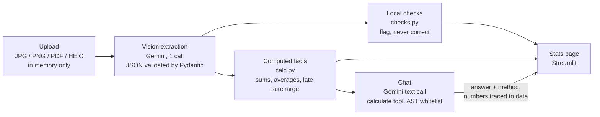

# BillAsaan ⚡

**Bijli ka bill, ab aasaan.** Upload a Pakistani electricity bill and get its key numbers, consistency checks and a
chat that answers questions about it in English, Urdu or Roman Urdu, with every number computed by code.

[](https://github.com/rameenzehraa/billAsaan/actions/workflows/tests.yml)
&nbsp;**Live demo:** `<PASTE URL>` <!-- TODO: replace with the https://….streamlit.app link -->

<!-- Demo GIF: record upload → Process → stats → a chat question, save as docs/demo.gif, then replace this line with:
 -->
> 🎬 *Demo GIF coming soon.*

Built in 3 hours at **Women Tech Quest 2026**, then productionized.

## What it does

1. **Upload** a bill photo, scan or PDF (JPG, PNG, PDF first page, HEIC; up to 8 MB). Any of the 11 DISCOs
   (IESCO, LESCO, K-Electric, MEPCO, FESCO, GEPCO, PESCO, HESCO, SEPCO, QESCO, TESCO).
2. **Process:** one vision call reads the bill into a Pydantic-validated structure.
3. **See the stats:** amount due, due date, late amount, units, charges and taxes, usage history chart, and
   consistency checks marked *Matched*, *Mismatch* or *Insufficient Data*.
4. **Ask** "Why is my bill this amount?", "What if I pay late?", "Mera bill itna zyada kyun hai?"

## Architecture



| File | Role |
|---|---|
| `app.py` | Streamlit page: consent, upload, stats, chat, limits, System stats |
| `extract.py` | One Gemini vision call per bill; strict Pydantic validation; one targeted re-ask |
| `checks.py` | Arithmetic and format checks (compare only) |
| `calc.py` | Deterministic facts used by chat (late surcharge, averages, trends, tax share) |
| `chat.py` | Grounded Q&A with a `calculate` tool; output schema, number tracing, identifier guard |
| `limits.py`, `telemetry.py` | Session/daily caps, quota fallback, in-memory stats |
| `run.py` | Original competition CLI: batch extraction to CSV |

## Design decisions

**Code does the math, not the model.** LLMs are unreliable at arithmetic, and a wrong rupee amount is worse than no
answer. Chat gets pre-computed facts from `calc.py`; anything else must go through a `calculate(expression)` tool,
evaluated with an AST whitelist (numbers, `+ - * / ( )`, `round/min/max/sum`; no `eval`). Every number in an answer
must trace back to the bill data, a fact or a tool result, or the answer is rejected and re-asked once.

**Checks flag issues; they never correct values.** If charges + taxes don't add up to the current bill, the user sees
*Mismatch* and the extracted numbers stay exactly as printed. Missing components give *Insufficient Data*, never a
false *Matched*. A passing check means "no inconsistency found", not "proven correct".

**Built for free-tier limits.** Per-session limits (3 bills, 15 questions per bill) and whole-app daily caps (150
extractions, 400 questions) protect the quota. A daily-quota 429 skips same-model retries and falls back once from
`gemini-3.5-flash-lite` to `gemini-3.1-flash-lite`; per-minute 429s get one short retry. When both models are
exhausted users see "Daily demo limit reached, try tomorrow", never a raw error. Results are cached per session by
image hash, so reruns cost nothing.

**Privacy first.** Bills are processed in memory and never written to disk or a shared cache. Images are re-encoded to
strip metadata. On the free tier a consent box explains that Google may use uploaded content and asks users to cover
their name, address and reference numbers. Logs and stats hold counts, timings and error categories only, never bill
content or questions. Chat refuses to repeat personal identifiers.

## Eval

[`eval/run_eval.py`](eval/README.md) measures per-field extraction accuracy (counting *invented* values and *missed*
values separately), charge and tax line matching by type, and whether chat answers state the number `calc.py`
computes.

**Status: no held-out accuracy number yet.**

- So far **n = 1** hand-verified bill: `KESC_0008`. That is the bill the extraction prompt was **tuned on** during
  the hackathon, so its scores ([eval/RESULTS.md](eval/RESULTS.md)) only show the pipeline runs end to end. They are
  not an accuracy claim.
- A **held-out eval is in progress:** real bills the prompt has never seen, each labelled field by field against
  the image.

| Held-out eval | Result |
|---|---|
| Bills (n) | _TBD_ |
| Level 1 field accuracy | _TBD_ |
| Invented / missed values | _TBD_ |
| Charge and tax lines (precision / recall) | _TBD_ |
| Chat number accuracy | _TBD_ |

## Run locally

```bash
python -m venv venv
venv\Scripts\activate            # macOS/Linux: source venv/bin/activate
pip install -r requirements.txt
cp .streamlit/secrets.toml.example .streamlit/secrets.toml   # or copy .env.example to .env
# put your Gemini API key in API_KEY
streamlit run app.py
```

Settings are read from Streamlit secrets first, then environment variables / `.env`: `API_KEY`, `MODEL_NAME`,
`FREE_TIER`, `MAX_BILLS_PER_SESSION`, `MAX_QUESTIONS_PER_BILL`, `DAILY_EXTRACTION_CAP`, `DAILY_CHAT_CAP`.
Deploying: see [DEPLOY.md](DEPLOY.md).

### Tests

```bash
python -m unittest tests.test_deploy tests.test_limits tests.test_chat tests.test_public_viewer tests.test_transport
```

85 tests, all offline: every model call is mocked. CI runs the same suite on every push and pull request with network
access blocked, so a test that tries to reach the internet fails the build.

### CLI batch mode (competition workflow)

```bash
python run.py --bills <bills_dir> --templates <csv_dir> --out output/
```

Reads every bill image in `<bills_dir>`, fills the `level1.csv` / `level2.csv` templates in `<csv_dir>` and writes
them to `output/`, with a per-bill summary (cache hit/miss, tokens, latency, checks). Successful extractions are cached
on disk; `--refresh` forces new calls.

## AI use and model declaration

- **Models:** Google `gemini-3.5-flash-lite` for extraction and chat; `gemini-3.1-flash-lite` as the quota fallback.
  Called through the `google-genai` SDK (`generate_content`), temperature 0, structured JSON output.
- **What the model does:** reads the bill image into fields; phrases chat answers and decides when to call the
  calculator. **What it doesn't do:** arithmetic, correcting values, or seeing anything except the bill data in chat.
- **Development:** built with AI coding assistants during and after the hackathon; design, review and verification of
  every change by the author.

## Limitations

- Extraction can still misread blurry or folded bills; the checks catch arithmetic inconsistencies, not every misread.
- Some bills print only combined charge or tax amounts, so line items show as subtotals (by design).
- Daily caps, the sample cache and stats live in memory and reset when the app restarts or sleeps.
- On the free tier Google may use uploaded content to improve its products; the consent box says so.
- The eval set is small; accuracy figures are indicative until more hand-verified bills are labelled.
- Not affiliated with any DISCO; always check the printed bill before paying.
